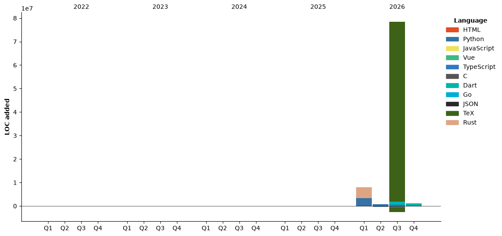

### Hi there 👋

- 🧐 I'm...
  -  咕咕mur / GuGuMur: Combination of Arknights Operator [Ptilopsis (白面鸮)](https://prts.wiki/w/白面鸮) and meme [MUR Cat](https://zh.moegirl.org.cn/MUR猫).
  -  HevCateon: **H**uo + D**ev** + **Cat** + Pig**eon** 
- 🌱 WHU; Learning CSS & C(C++) & Go & Rust...
- 💻 OS: Windows 11 & Zorin OS(Ubuntu)
- 🎮 Game in progress: Arknights(CN), Touhou Official/Fan Games, Roguelike [[Steam](https://steamcommunity.com/id/GuGuMur/)]
- 🎵 Favored music: Touhou Official/Fan music, Eurobeat, Artcore, Symphony
- 🎻 Classical music player: Violin & Viola

----
<details>

<summary>Coding Summary [wakatime]</summary>

<!--START_SECTION:waka-->


**🐱 My GitHub Data** 

> 📦 160.3 kB Used in GitHub's Storage 
 > 
> 🏆 462 Contributions in the Year 2026
 > 
> 🚫 Not Opted to Hire
 > 
> 📜 84 Public Repositories 
 > 
> 🔑 7 Private Repositories 
 > 
**I'm an Early 🐤** 

```text
🌞 Morning                384 commits         █████░░░░░░░░░░░░░░░░░░░░   18.77 % 
🌆 Daytime                704 commits         █████████░░░░░░░░░░░░░░░░   34.41 % 
🌃 Evening                925 commits         ███████████░░░░░░░░░░░░░░   45.21 % 
🌙 Night                  33 commits          ░░░░░░░░░░░░░░░░░░░░░░░░░   01.61 % 
```
📅 **I'm Most Productive on Friday** 

```text
Monday                   201 commits         ██░░░░░░░░░░░░░░░░░░░░░░░   09.82 % 
Tuesday                  202 commits         ██░░░░░░░░░░░░░░░░░░░░░░░   09.87 % 
Wednesday                149 commits         ██░░░░░░░░░░░░░░░░░░░░░░░   07.28 % 
Thursday                 294 commits         ████░░░░░░░░░░░░░░░░░░░░░   14.37 % 
Friday                   519 commits         ██████░░░░░░░░░░░░░░░░░░░   25.37 % 
Saturday                 218 commits         ███░░░░░░░░░░░░░░░░░░░░░░   10.65 % 
Sunday                   463 commits         ██████░░░░░░░░░░░░░░░░░░░   22.63 % 
```


📊 **This Week I Spent My Time On** 

```text
🕑︎ Time Zone: Asia/Shanghai

💬 Programming Languages: 
Other                    23 hrs 45 mins      ████████████████████░░░░░   81.67 % 
Markdown                 5 hrs 19 mins       █████░░░░░░░░░░░░░░░░░░░░   18.33 % 

🔥 Editors: 
Edge                     29 hrs 5 mins       █████████████████████████   100.00 % 

🐱‍💻 Projects: 
coder_books              7 hrs 9 mins        ██████░░░░░░░░░░░░░░░░░░░   24.62 % 
GuBot-TrapAction         3 hrs 43 mins       ███░░░░░░░░░░░░░░░░░░░░░░   12.82 % 
SenseNova-RoboRSI        3 hrs 25 mins       ███░░░░░░░░░░░░░░░░░░░░░░   11.78 % 
Luotopia-app             3 hrs 11 mins       ███░░░░░░░░░░░░░░░░░░░░░░   10.97 % 
generic-pixel-svg-rebuild2 hrs 39 mins       ██░░░░░░░░░░░░░░░░░░░░░░░   09.11 % 
```

🤖 **AI Coding This Week** 

```text
No AI Coding Activity Tracked This Week
```

**I Mostly Code in Python** 

```text
TypeScript               12 repos            █████░░░░░░░░░░░░░░░░░░░░   19.67 % 
Go                       5 repos             ██░░░░░░░░░░░░░░░░░░░░░░░   08.20 % 
Vue                      5 repos             ██░░░░░░░░░░░░░░░░░░░░░░░   08.20 % 
Typst                    1 repo              ░░░░░░░░░░░░░░░░░░░░░░░░░   01.64 % 
CSS                      1 repo              ░░░░░░░░░░░░░░░░░░░░░░░░░   01.64 % 
```


**Timeline**




 Last Updated on 2026.47.11/01/26 14:47:15 UTC
<!--END_SECTION:waka-->

<!--  -->

</details>
